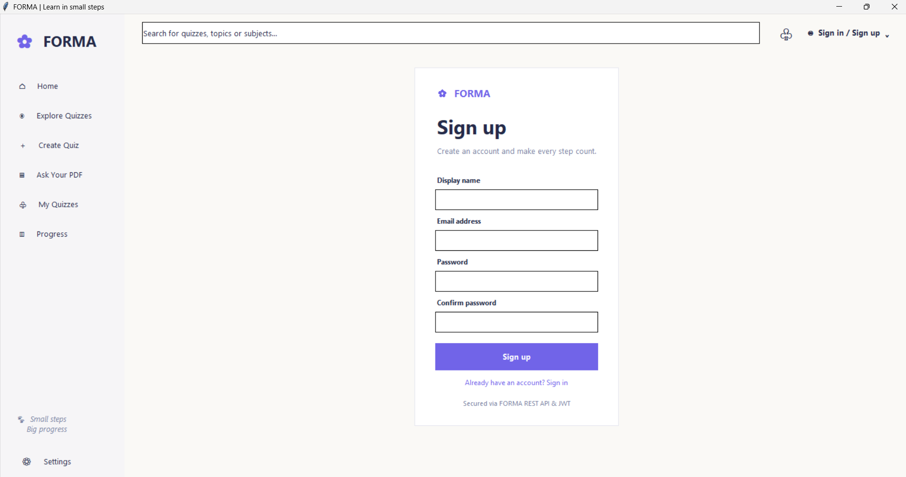
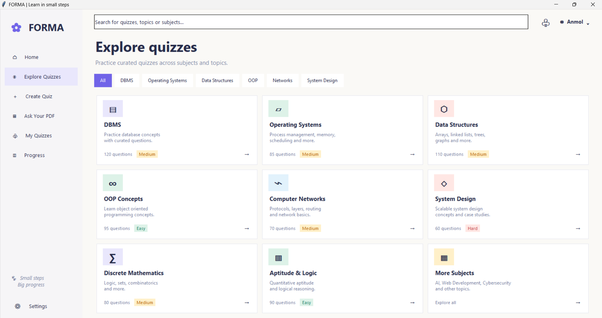
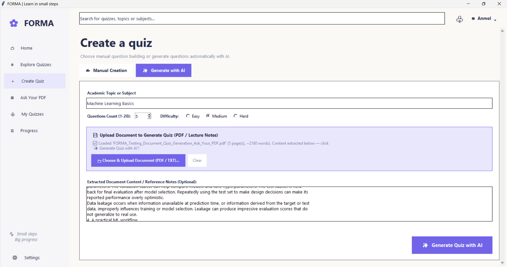
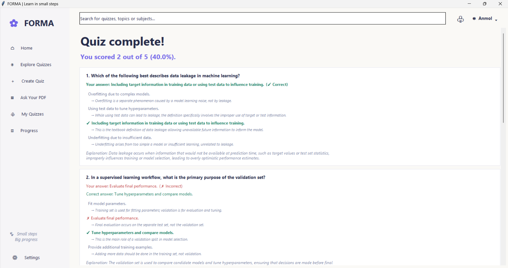
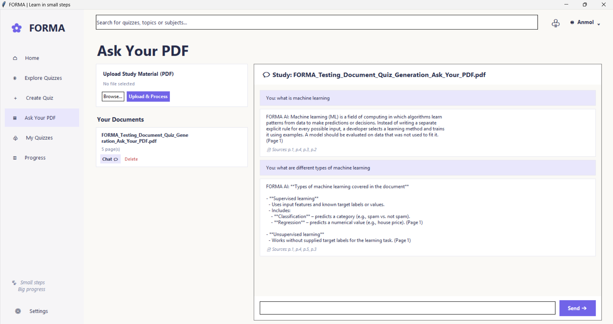
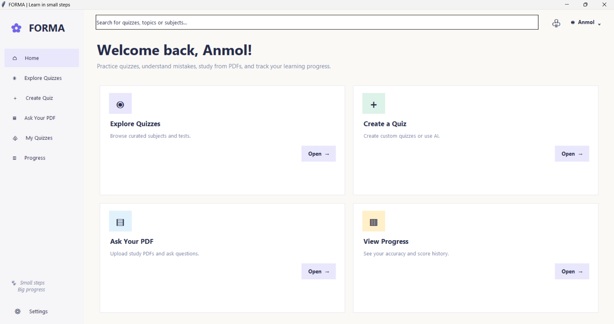

# FORMA

**FORMA** is an AI-powered quiz and study platform built for students to create quizzes, practice questions, understand mistakes, study from PDFs, and track their learning progress.

The application consists of a modern **Python Tkinter Desktop GUI** frontend integrated with a robust **Flask REST API** backend powered by SQLAlchemy, SQLite / PostgreSQL, Groq Cloud LLM, and PyMuPDF document extraction.

---

## 📸 Application Screenshots

*(Application UI in action)*

| Desktop App & Authentication | Explore & Take Quizzes |
|:---:|:---:|
|  |  |

| AI Quiz Generation (Groq) | Review with Per-Option Explanations |
|:---:|:---:|
|  |  |

| Ask Your PDF (RAG Chat with Citations) | Progress & Performance Dashboard |
|:---:|:---:|
|  |  |

---

## ✨ Key Features

1. **AI Quiz Generation (Groq Cloud)**:
   - Powered by `openai/gpt-oss-20b` via Groq's high-speed inference API.
   - Generates multi-question assessments customized by topic, difficulty, and question count.
   - Enforces structured JSON output validated with Pydantic schemas.

2. **Per-Option Explanations**:
   - In addition to overall question explanations, each option (both correct and distractors) includes an individual educational explanation detailing why it is correct or incorrect.
   - Displayed in the post-quiz review screen to provide comprehensive learning feedback.

3. **"Ask Your PDF" RAG Pipeline**:
   - Extracts page-by-page text from uploaded lecture slides or notes via PyMuPDF.
   - Built-in TF-IDF keyword retrieval scores and selects the most relevant document pages.
   - Grounded LLM generation ensures responses cite page numbers (e.g., `(Page 1)`) and eliminates hallucinations.

4. **Progress Analytics**:
   - Tracks quiz attempts, correct answers, total questions answered, and percentage accuracy.
   - Visual dashboard renders progress summaries and performance breakdown.

---

## 🎯 Architecture & Technology Stack

- **Frontend (Desktop GUI)**: Built with Python Tkinter, styled with a modern design system (`desktop_app/theme.py`), structured API client (`desktop_app/services/api_client.py`), and modular pages (`desktop_app/app.py`).
- **Backend (REST API)**: Flask, Flask-SQLAlchemy, Flask-Migrate, Flask-JWT-Extended, Flask-CORS, and Pydantic v2.
- **AI & RAG Services**: Provider-agnostic OpenAI client (`backend/app/ai/llm_client.py`), AI quiz generator (`backend/app/ai/quiz_generator.py`), and TF-IDF grounded RAG service (`backend/app/ai/rag_service.py`).
- **PDF Extraction**: PyMuPDF (`fitz`) extracting structured text and page metadata.

---

## 🚀 Quick Setup & Execution (Windows / PowerShell)

### Prerequisites
- Python 3.10+ (Python 3.11–3.13 tested)
- Built-in Tkinter

### 1. Initialize Virtual Environment & Install Dependencies
```powershell
python -m venv venv
.\venv\Scripts\Activate.ps1
pip install -r backend/requirements.txt
```

### 2. Configure Environment
A `.env` file is located in `backend/.env`. Ensure your Groq API key is present:
```ini
LLM_PROVIDER=openai
OPENAI_API_KEY=gsk_...
OPENAI_BASE_URL=https://api.groq.com/openai/v1
OPENAI_MODEL=openai/gpt-oss-20b
LLM_TIMEOUT_SECONDS=60
```

### 3. Apply Database Migrations
```powershell
flask --app backend.app:create_app db upgrade --directory backend/migrations
```

### 4. Start the Backend API
In one terminal:
```powershell
python backend/run.py
```
- API Base URL: `http://localhost:5000/api/v1`
- Health check: `http://localhost:5000/api/v1/health`

### 5. Launch the Desktop Application
In a second terminal:
```powershell
python -m desktop_app.main
```

### 6. Run Automated Tests
```powershell
pytest
ruff check .
```

---

## 📖 Project Documentation

Complete documentation is located in the [`docs/`](docs/) directory:
- [API Contract](docs/API_CONTRACT.md): Complete REST endpoint specifications, request/response formats, and status codes.
- [Database Schema](docs/DATABASE_SCHEMA.md): Normalized relational schema with Mermaid ER diagram and cascade rules.
- [Backend Architecture](docs/BACKEND_ARCHITECTURE.md): Multi-layer architecture and security boundaries.
- [AI Quiz Generation](docs/AI_GENERATION.md): Provider-agnostic LLM client abstraction and structured validation.
- [RAG Integration Guide](docs/RAG_INTEGRATION.md): Interface documentation and TF-IDF retrieval pipeline.
- [Frontend Integration Checklist](docs/INTEGRATION_CHECKLIST.md): Practical checklist for frontend integration.
- [OpenAPI Specification](docs/openapi.json): Standard OpenAPI 3.0.3 specification file for Swagger or Postman import.
