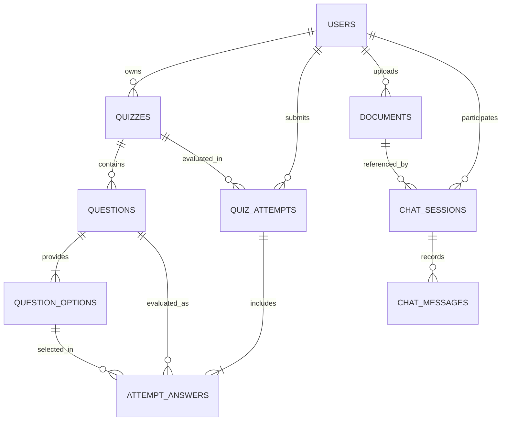

# FORMA Database Schema Documentation

## Entity Relationship Diagram

---

## Tables

### 1. `users`
Represents registered students and platform users.

| Column | Type | Constraints | Description |
| :--- | :--- | :--- | :--- |
| `id` | `VARCHAR(36)` | `PRIMARY KEY` | UUIDv4 string |
| `email` | `VARCHAR(255)` | `NOT NULL, UNIQUE, INDEX` | Lowercase normalized email |
| `display_name` | `VARCHAR(100)` | `NOT NULL` | Student display name |
| `password_hash` | `VARCHAR(255)` | `NOT NULL` | Werkzeug salted scrypt/pbkdf2 hash |
| `account_status` | `VARCHAR(20)` | `NOT NULL, DEFAULT 'active'` | `"active"`, `"suspended"` |
| `created_at` | `DATETIME` | `NOT NULL` | UTC timestamp |
| `updated_at` | `DATETIME` | `NOT NULL` | UTC timestamp |

---

### 2. `quizzes`
Quizzes created manually or generated by AI.

| Column | Type | Constraints | Description |
| :--- | :--- | :--- | :--- |
| `id` | `VARCHAR(36)` | `PRIMARY KEY` | UUIDv4 string |
| `owner_id` | `VARCHAR(36)` | `NOT NULL, FK(users.id, ON DELETE CASCADE), INDEX` | Creator |
| `title` | `VARCHAR(200)` | `NOT NULL` | Quiz title |
| `description` | `TEXT` | `NULLABLE` | Quiz summary |
| `visibility` | `VARCHAR(20)` | `NOT NULL, DEFAULT 'private'` | `"private"` or `"public"` |
| `generation_metadata` | `JSON` | `NULLABLE` | Model, prompt tokens, generation parameters |
| `created_at` | `DATETIME` | `NOT NULL` | UTC timestamp |
| `updated_at` | `DATETIME` | `NOT NULL` | UTC timestamp |

---

### 3. `questions`
Multiple-choice questions within a quiz.

| Column | Type | Constraints | Description |
| :--- | :--- | :--- | :--- |
| `id` | `VARCHAR(36)` | `PRIMARY KEY` | UUIDv4 string |
| `quiz_id` | `VARCHAR(36)` | `NOT NULL, FK(quizzes.id, ON DELETE CASCADE), INDEX` | Parent quiz |
| `prompt` | `TEXT` | `NOT NULL` | Question statement |
| `explanation` | `TEXT` | `NULLABLE` | Pedagogical rationale (masked during taking) |
| `display_position` | `INTEGER` | `NOT NULL, DEFAULT 0` | Ordering index |
| `topic` | `VARCHAR(100)` | `NULLABLE` | Specific subject topic |
| `difficulty` | `VARCHAR(50)` | `NULLABLE` | `"easy"`, `"medium"`, `"hard"` |
| `created_at` | `DATETIME` | `NOT NULL` | UTC timestamp |

---

### 4. `question_options`
Choices for each question. Exactly one option per question has `is_correct = true`.

| Column | Type | Constraints | Description |
| :--- | :--- | :--- | :--- |
| `id` | `VARCHAR(36)` | `PRIMARY KEY` | UUIDv4 string |
| `question_id` | `VARCHAR(36)` | `NOT NULL, FK(questions.id, ON DELETE CASCADE), INDEX` | Parent question |
| `option_text` | `TEXT` | `NOT NULL` | Option content |
| `is_correct` | `BOOLEAN` | `NOT NULL, DEFAULT FALSE` | Correctness flag (masked during taking) |

---

### 5. `quiz_attempts`
Records an instance of a student completing a quiz.

| Column | Type | Constraints | Description |
| :--- | :--- | :--- | :--- |
| `id` | `VARCHAR(36)` | `PRIMARY KEY` | UUIDv4 string |
| `user_id` | `VARCHAR(36)` | `NOT NULL, FK(users.id, ON DELETE CASCADE), INDEX` | Student |
| `quiz_id` | `VARCHAR(36)` | `NOT NULL, FK(quizzes.id, ON DELETE CASCADE), INDEX` | Target quiz |
| `score` | `INTEGER` | `NOT NULL, DEFAULT 0` | Evaluated points |
| `total_questions` | `INTEGER` | `NOT NULL, DEFAULT 0` | Total questions in quiz |
| `submitted_at` | `DATETIME` | `NOT NULL` | UTC timestamp |

---

### 6. `attempt_answers`
Stores each answered or unanswered question within an attempt.

| Column | Type | Constraints | Description |
| :--- | :--- | :--- | :--- |
| `id` | `VARCHAR(36)` | `PRIMARY KEY` | UUIDv4 string |
| `attempt_id` | `VARCHAR(36)` | `NOT NULL, FK(quiz_attempts.id, ON DELETE CASCADE), INDEX` | Parent attempt |
| `question_id` | `VARCHAR(36)` | `NOT NULL, FK(questions.id, ON DELETE CASCADE)` | Evaluated question |
| `selected_option_id` | `VARCHAR(36)` | `NULLABLE, FK(question_options.id, ON DELETE SET NULL)` | Selected answer |
| `is_correct` | `BOOLEAN` | `NOT NULL, DEFAULT FALSE` | Correctness snapshot |
| `answered_at` | `DATETIME` | `NOT NULL` | UTC timestamp |

---

### 7. `documents`
Uploaded study materials (PDFs).

| Column | Type | Constraints | Description |
| :--- | :--- | :--- | :--- |
| `id` | `VARCHAR(36)` | `PRIMARY KEY` | UUIDv4 string |
| `owner_id` | `VARCHAR(36)` | `NOT NULL, FK(users.id, ON DELETE CASCADE), INDEX` | Uploader |
| `original_filename` | `VARCHAR(255)` | `NOT NULL` | Sanitized original client filename |
| `storage_path` | `VARCHAR(500)` | `NOT NULL` | Private filesystem path (never exposed) |
| `file_size_bytes` | `INTEGER` | `NOT NULL, DEFAULT 0` | File size |
| `processing_status` | `VARCHAR(50)` | `NOT NULL, DEFAULT 'ready'` | `"processing"`, `"ready"`, `"failed"` |
| `page_count` | `INTEGER` | `NOT NULL, DEFAULT 0` | Extracted page count |
| `extracted_text_metadata` | `JSON` | `NULLABLE` | List of page texts and char counts |
| `created_at` | `DATETIME` | `NOT NULL` | UTC timestamp |
| `updated_at` | `DATETIME` | `NOT NULL` | UTC timestamp |

---

### 8. `chat_sessions`
Conversational study sessions linked to a specific uploaded PDF.

| Column | Type | Constraints | Description |
| :--- | :--- | :--- | :--- |
| `id` | `VARCHAR(36)` | `PRIMARY KEY` | UUIDv4 string |
| `user_id` | `VARCHAR(36)` | `NOT NULL, FK(users.id, ON DELETE CASCADE), INDEX` | Student |
| `document_id` | `VARCHAR(36)` | `NOT NULL, FK(documents.id, ON DELETE CASCADE), INDEX` | Referenced document |
| `title` | `VARCHAR(200)` | `NOT NULL` | Session title |
| `created_at` | `DATETIME` | `NOT NULL` | UTC timestamp |
| `updated_at` | `DATETIME` | `NOT NULL` | UTC timestamp |

---

### 9. `chat_messages`
Individual dialog turns in a chat session.

| Column | Type | Constraints | Description |
| :--- | :--- | :--- | :--- |
| `id` | `VARCHAR(36)` | `PRIMARY KEY` | UUIDv4 string |
| `session_id` | `VARCHAR(36)` | `NOT NULL, FK(chat_sessions.id, ON DELETE CASCADE), INDEX` | Parent session |
| `role` | `VARCHAR(20)` | `NOT NULL` | `"user"`, `"assistant"`, `"system"` |
| `content` | `TEXT` | `NOT NULL` | Message body |
| `citations` | `JSON` | `NULLABLE` | Page citations list: `[{"page_number": int, "snippet": str}]` |
| `created_at` | `DATETIME` | `NOT NULL` | UTC timestamp |
